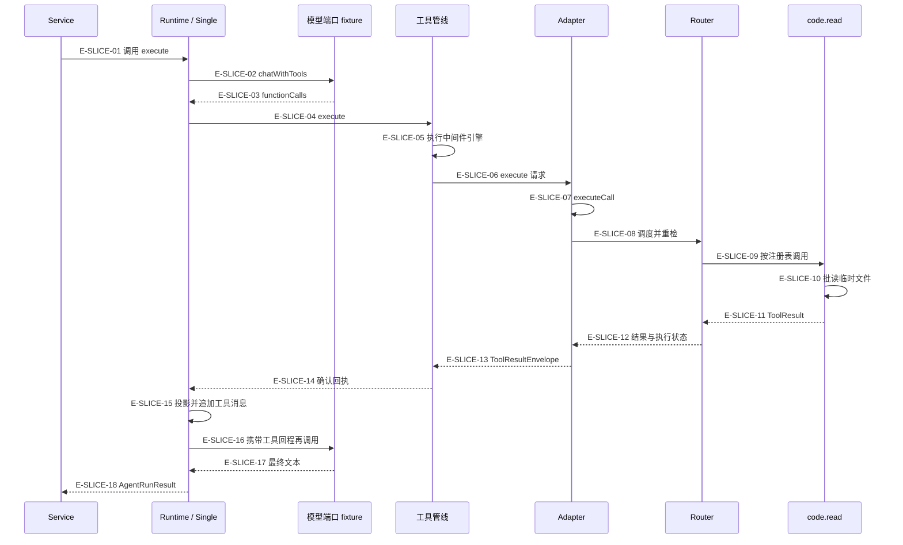

# 一次请求到工具回执 · 完整时序

这张图沿已执行的 Single 样板连续走到第二次模型请求和 Service 返回。实线表示调用或内部步骤；虚线表示结果回程。它不把脚本 provider 画成真实供应商，也不把 host port 画成已经部署的外部服务。

[样板说明](overview.md) · [分段调用依据](call-flow.md) · [六种状态与恢复](receipt-and-recovery.md)

### 本图术语说明

| 名称 | 本图含义 |
| --- | --- |
| Service | 校验、编译、真实 Builder 装配与结果投影。 |
| Runtime / Single | 运行边界与本样板的单策略循环；其他策略另见专题02。 |
| 模型端口 fixture | 脚本化 chatWithTools；模型文本可信度、真实网络与 SDK 未在此验证。 |
| 工具管线 | before 门／短路、executor、after 观察；回执只保留已确认事实。 |
| Adapter / Router | 合同信封、宿主上下文、准入、并发 slot 与 handler 调用。 |
| code.read | 真实文件读取实现；仅处理临时 fixture。 |

| 编号 | 代码依据 | 测试依据 | 关系与可证明范围 |
| --- | --- | --- | --- |
| E-SLICE-01 | `src/agent/service/AgentService.ts#AgentService.run` → `src/agent/runtime/AgentRuntime.ts#AgentRuntime.execute` | `alembic-agent-architecture-atlas/test/pilot.test.ts#case:success%3A%20receipt%20is%20returned%20to%20the%20second%20model%20turn%20and%20projected%20by%20Service`；断言已定位，实际执行见页面证据。样板装配：Service/Builder/Runtime/Pipeline/Adapter/Router/code.read 未替换，provider 为脚本，断言真实内容进入第二轮 role=tool 消息及最终 toolCalls。接缝定位由代码正文补充。 | 先编译与真实 Builder 装配；Single 策略在 runOperation 边界内调用 reactLoop。 |
| E-SLICE-02 | `src/agent/runtime/AgentRuntime.ts#AgentRuntime.callLLM` → `src/agent/service/AgentRuntimeBuilder.ts#AgentRuntimeBuilder.build` | `alembic-agent-architecture-atlas/test/pilot.test.ts#case:success%3A%20receipt%20is%20returned%20to%20the%20second%20model%20turn%20and%20projected%20by%20Service`；断言已定位，实际执行见页面证据。样板装配：Service/Builder/Runtime/Pipeline/Adapter/Router/code.read 未替换，provider 为脚本，断言真实内容进入第二轮 role=tool 消息及最终 toolCalls。接缝定位由代码正文补充。 | Builder 注入模型端口。本样板是脚本化 provider，未经过 AiProvider/HTTP transport。 |
| E-SLICE-03 | `src/agent/runtime/AgentRuntime.ts#AgentRuntime.callLLM` → `src/agent/runtime/AgentRuntime.ts#AgentRuntime.processToolCalls` | `alembic-agent-architecture-atlas/test/pilot.test.ts#case:success%3A%20receipt%20is%20returned%20to%20the%20second%20model%20turn%20and%20projected%20by%20Service`；断言已定位，实际执行见页面证据。样板装配：Service/Builder/Runtime/Pipeline/Adapter/Router/code.read 未替换，provider 为脚本，断言真实内容进入第二轮 role=tool 消息及最终 toolCalls。接缝定位由代码正文补充。 | 受控模型输出 code.read；Runtime 经工具钩子与管线准入后才进入 executor。 |
| E-SLICE-04 | `src/agent/runtime/AgentRuntime.ts#AgentRuntime.processToolCalls` → `src/agent/runtime/ToolExecutionPipeline.ts#ToolExecutionPipeline.execute` | `alembic-agent-architecture-atlas/test/pilot.test.ts#case:success%3A%20receipt%20is%20returned%20to%20the%20second%20model%20turn%20and%20projected%20by%20Service`；断言已定位，实际执行见页面证据。样板装配：Service/Builder/Runtime/Pipeline/Adapter/Router/code.read 未替换，provider 为脚本，断言真实内容进入第二轮 role=tool 消息及最终 toolCalls。接缝定位由代码正文补充。 | 将 function call 和 loop context 传入默认管线；before 拒绝可在 Router 前结束。 |
| E-SLICE-05 | `src/agent/runtime/ToolExecutionPipeline.ts#ToolExecutionPipeline.execute` → `src/agent/runtime/toolPipeline/engine.ts#executeToolPipeline` | `alembic-agent-architecture-atlas/test/pilot.test.ts#case:success%3A%20receipt%20is%20returned%20to%20the%20second%20model%20turn%20and%20projected%20by%20Service`；断言已定位，实际执行见页面证据。样板装配：Service/Builder/Runtime/Pipeline/Adapter/Router/code.read 未替换，provider 为脚本，断言真实内容进入第二轮 role=tool 消息及最终 toolCalls。接缝定位由代码正文补充。 | 中间件集合与 executeRuntimeToolCall 显式传给 engine；默认 gate、重复复用、after 顺序由 createToolPipeline 决定。 |
| E-SLICE-06 | `src/agent/runtime/toolPipeline/runtimeBridge.ts#executeRuntimeToolCall` → `src/tools/runtime/adapter/ToolRouterAdapter.ts#ToolRouterAdapter.execute` | `alembic-agent-architecture-atlas/test/pilot.test.ts#case:success%3A%20receipt%20is%20returned%20to%20the%20second%20model%20turn%20and%20projected%20by%20Service`；断言已定位，实际执行见页面证据。样板装配：Service/Builder/Runtime/Pipeline/Adapter/Router/code.read 未替换，provider 为脚本，断言真实内容进入第二轮 role=tool 消息及最终 toolCalls。接缝定位由代码正文补充。 | engine 通过注入 executor 到 runtimeBridge；请求绑定 surface/runtime/allowedTools/signal。 |
| E-SLICE-07 | `src/tools/runtime/adapter/ToolRouterAdapter.ts#ToolRouterAdapter.execute` → `src/tools/runtime/adapter/ToolRouterAdapter.ts#ToolRouterAdapter.executeCall` | `alembic-agent-architecture-atlas/test/pilot.test.ts#case:success%3A%20receipt%20is%20returned%20to%20the%20second%20model%20turn%20and%20projected%20by%20Service`；断言已定位，实际执行见页面证据。样板装配：Service/Builder/Runtime/Pipeline/Adapter/Router/code.read 未替换，provider 为脚本，断言真实内容进入第二轮 role=tool 消息及最终 toolCalls。接缝定位由代码正文补充。 | execute 复制请求并委托私有 executeCall；解析与准入、contextFactory.create 后进入 Router。 |
| E-SLICE-08 | `src/tools/runtime/adapter/ToolRouterAdapter.ts#ToolRouterAdapter.executeCall` → `src/tools/runtime/router.ts#ToolRouter.execute` | `alembic-agent-architecture-atlas/test/pilot.test.ts#case:success%3A%20receipt%20is%20returned%20to%20the%20second%20model%20turn%20and%20projected%20by%20Service`；断言已定位，实际执行见页面证据。样板装配：Service/Builder/Runtime/Pipeline/Adapter/Router/code.read 未替换，provider 为脚本，断言真实内容进入第二轮 role=tool 消息及最终 toolCalls。接缝定位由代码正文补充。 | 当前宿主 availability 与阶段权限约束进入真实 router；获得 slot 后再次检查。 |
| E-SLICE-09 | `src/tools/runtime/router.ts#ToolRouter.execute` → `src/tools/runtime/registry.ts#CODE_SPEC` | `alembic-agent-architecture-atlas/test/pilot.test.ts#case:success%3A%20receipt%20is%20returned%20to%20the%20second%20model%20turn%20and%20projected%20by%20Service`；断言已定位，实际执行见页面证据。样板装配：Service/Builder/Runtime/Pipeline/Adapter/Router/code.read 未替换，provider 为脚本，断言真实内容进入第二轮 role=tool 消息及最终 toolCalls。接缝定位由代码正文补充。 | action.handler 来自 TOOL_REGISTRY；CODE_SPEC.read 的闭包调用 handleCode(read)。 |
| E-SLICE-10 | `src/tools/runtime/handlers/code.ts#handleRead` → `src/tools/runtime/handlers/code.ts#readSingleFile` | `alembic-agent-architecture-atlas/test/pilot.test.ts#case:success%3A%20receipt%20is%20returned%20to%20the%20second%20model%20turn%20and%20projected%20by%20Service`；断言已定位，实际执行见页面证据。样板装配：Service/Builder/Runtime/Pipeline/Adapter/Router/code.read 未替换，provider 为脚本，断言真实内容进入第二轮 role=tool 消息及最终 toolCalls。接缝定位由代码正文补充。 | handleRead→handleBatchRead→readSingleFile；路径边界检查通过后 fs.readFile。fixture 路径不写入图谱。 |
| E-SLICE-11 | `src/tools/runtime/handlers/code.ts#handleBatchRead` → `src/tools/runtime/router.ts#ToolRouter.execute` | `alembic-agent-architecture-atlas/test/pilot.test.ts#case:success%3A%20receipt%20is%20returned%20to%20the%20second%20model%20turn%20and%20projected%20by%20Service`；断言已定位，实际执行见页面证据。样板装配：Service/Builder/Runtime/Pipeline/Adapter/Router/code.read 未替换，provider 为脚本，断言真实内容进入第二轮 role=tool 消息及最终 toolCalls。接缝定位由代码正文补充。 | handler 返回 data/files/summary 与 _meta；部分文件失败是 partial，不抹掉成功项。 |
| E-SLICE-12 | `src/tools/runtime/router.ts#ToolRouter.execute` → `src/tools/runtime/adapter/ToolRouterAdapter.ts#ToolRouterAdapter.toEnvelope` | `alembic-agent-architecture-atlas/test/pilot.test.ts#case:success%3A%20receipt%20is%20returned%20to%20the%20second%20model%20turn%20and%20projected%20by%20Service`；断言已定位，实际执行见页面证据。样板装配：Service/Builder/Runtime/Pipeline/Adapter/Router/code.read 未替换，provider 为脚本，断言真实内容进入第二轮 role=tool 消息及最终 toolCalls。接缝定位由代码正文补充。 | Router 返回后 Adapter 组装 canonical envelope；handler 执行状态与 JSON 安全展示分开。 |
| E-SLICE-13 | `src/tools/runtime/adapter/ToolRouterAdapter.ts#ToolRouterAdapter.toEnvelope` → `src/agent/runtime/toolPipeline/runtimeBridge.ts#recordExecutedEnvelope` | `alembic-agent-architecture-atlas/test/pilot.test.ts#case:success%3A%20receipt%20is%20returned%20to%20the%20second%20model%20turn%20and%20projected%20by%20Service`；断言已定位，实际执行见页面证据。样板装配：Service/Builder/Runtime/Pipeline/Adapter/Router/code.read 未替换，provider 为脚本，断言真实内容进入第二轮 role=tool 消息及最终 toolCalls。接缝定位由代码正文补充。 | 桥层记录 envelope 与单次诊断并做模型私有字段投影；after 中间件按装配顺序处理。 |
| E-SLICE-14 | `src/agent/runtime/toolPipeline/engine.ts#executeToolPipeline` → `src/agent/runtime/toolReceipt.ts#createToolReceipt` | `alembic-agent-architecture-atlas/test/pilot.test.ts#case:success%3A%20receipt%20is%20returned%20to%20the%20second%20model%20turn%20and%20projected%20by%20Service`；断言已定位，实际执行见页面证据。样板装配：Service/Builder/Runtime/Pipeline/Adapter/Router/code.read 未替换，provider 为脚本，断言真实内容进入第二轮 role=tool 消息及最终 toolCalls。接缝定位由代码正文补充。 | Runtime 在管线返回后构建 ToolCallEntry，保存 result/envelope 身份并写入两份历史。 |
| E-SLICE-15 | `src/agent/runtime/toolReceipt.ts#projectToolReceipt` → `src/agent/runtime/MessageAdapter.ts#SimpleArrayAdapter.appendToolResult` | `alembic-agent-architecture-atlas/test/pilot.test.ts#case:success%3A%20receipt%20is%20returned%20to%20the%20second%20model%20turn%20and%20projected%20by%20Service`；断言已定位，实际执行见页面证据。样板装配：Service/Builder/Runtime/Pipeline/Adapter/Router/code.read 未替换，provider 为脚本，断言真实内容进入第二轮 role=tool 消息及最终 toolCalls。接缝定位由代码正文补充。 | Runtime 使用投影文本调用 messages.appendToolResult；本样板未注入 ContextWindow，因此是 SimpleArrayAdapter。配额不能当作原始回执的替代。 |
| E-SLICE-16 | `src/agent/runtime/AgentRuntime.ts#AgentRuntime.callLLM` → `src/agent/runtime/MessageAdapter.ts#SimpleArrayAdapter.toMessages` | `alembic-agent-architecture-atlas/test/pilot.test.ts#case:success%3A%20receipt%20is%20returned%20to%20the%20second%20model%20turn%20and%20projected%20by%20Service`；断言已定位，实际执行见页面证据。样板装配：Service/Builder/Runtime/Pipeline/Adapter/Router/code.read 未替换，provider 为脚本，断言真实内容进入第二轮 role=tool 消息及最终 toolCalls。接缝定位由代码正文补充。 | 下一模型轮收到 role=tool、toolCallId=pilot-read 的消息；实际测试只在该消息中断言真实文件内容与失败项。 |
| E-SLICE-17 | `src/agent/runtime/AgentRuntime.ts#AgentRuntime.processTextResponse` → `src/agent/strategies/SingleStrategy.ts#SingleStrategy.execute` | `alembic-agent-architecture-atlas/test/pilot.test.ts#case:success%3A%20receipt%20is%20returned%20to%20the%20second%20model%20turn%20and%20projected%20by%20Service`；断言已定位，实际执行见页面证据。样板装配：Service/Builder/Runtime/Pipeline/Adapter/Router/code.read 未替换，provider 为脚本，断言真实内容进入第二轮 role=tool 消息及最终 toolCalls。接缝定位由代码正文补充。 | 无新的工具调用，文本结束 Single loop。这里没有证明知识入库或质量门通过。 |
| E-SLICE-18 | `src/agent/runtime/AgentRuntime.ts#AgentRuntime.execute` → `src/agent/service/AgentService.ts#inferRunStatus` | `alembic-agent-architecture-atlas/test/pilot.test.ts#case:success%3A%20receipt%20is%20returned%20to%20the%20second%20model%20turn%20and%20projected%20by%20Service`；断言已定位，实际执行见页面证据。样板装配：Service/Builder/Runtime/Pipeline/Adapter/Router/code.read 未替换，provider 为脚本，断言真实内容进入第二轮 role=tool 消息及最终 toolCalls。接缝定位由代码正文补充。 | Service 投影 reply/toolCalls/usage/diagnostics，并根据执行事实分类。成功文本可与 prior partial/blocked 工具记录共存。 |

## 这条样板没有跨过的边界

真实 provider 的协议、重试和原生续接见专题04；知识创建与 Core 读回见专题08；Strict 封印与 G2 已知缺口见专题10。本样板没有注入 releaseScope，不能声称已验证真实宿主资源释放。
