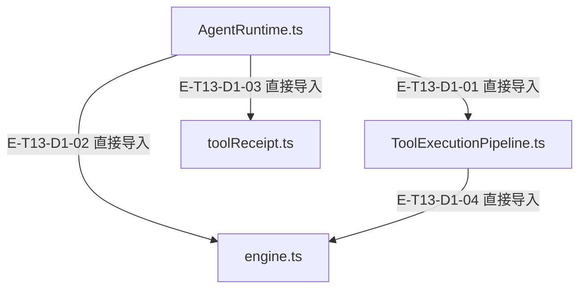
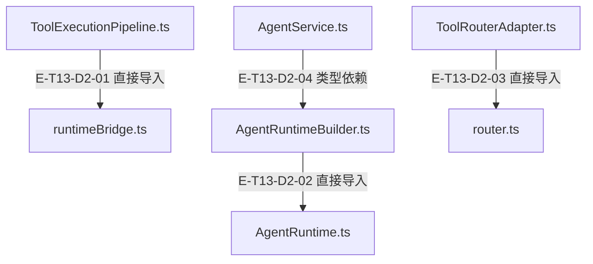

# 一次请求到工具回执 · 精选直接依赖

[职责与边界](overview.md) · [真实调用](call-flow.md)

选取本专题入口的最多8条直接依赖；完整库存可在阅读器「文件与依赖」查看。以仓库全路径为节点身份，同名文件不会合并。Core／Node／第三方包只在完整探索器的外部边界出现。

## 静态依赖 1

### 本图术语说明

| 术语／节点 | 含义与范围 |
| --- | --- |
| AgentRuntime.ts | `src/agent/runtime/AgentRuntime.ts`；文件直接依赖，箭头不表示执行先后。 |
| ToolExecutionPipeline.ts | `src/agent/runtime/ToolExecutionPipeline.ts`；文件直接依赖，箭头不表示执行先后。 |
| engine.ts | `src/agent/runtime/toolPipeline/engine.ts`；文件直接依赖，箭头不表示执行先后。 |
| toolReceipt.ts | `src/agent/runtime/toolReceipt.ts`；文件直接依赖，箭头不表示执行先后。 |

| 编号 | 代码依据 | 测试依据 | 关系与可证明范围 |
| --- | --- | --- | --- |
| E-T13-D1-01 | `src/agent/runtime/AgentRuntime.ts` → `src/agent/runtime/ToolExecutionPipeline.ts` | 未覆盖：静态依赖由本图谱解析器反例测试支持；不把 import 当作行为覆盖。 | TypeScript AST 解析 ./ToolExecutionPipeline.js；第 132 行，kind=import，typeOnly=false。只证明结构关系。 |
| E-T13-D1-02 | `src/agent/runtime/AgentRuntime.ts` → `src/agent/runtime/toolPipeline/engine.ts` | 未覆盖：静态依赖由本图谱解析器反例测试支持；不把 import 当作行为覆盖。 | TypeScript AST 解析 ./toolPipeline/engine.js；第 137 行，kind=import，typeOnly=false。只证明结构关系。 |
| E-T13-D1-03 | `src/agent/runtime/AgentRuntime.ts` → `src/agent/runtime/toolReceipt.ts` | 未覆盖：静态依赖由本图谱解析器反例测试支持；不把 import 当作行为覆盖。 | TypeScript AST 解析 ./toolReceipt.js；第 138 行，kind=import，typeOnly=false。只证明结构关系。 |
| E-T13-D1-04 | `src/agent/runtime/ToolExecutionPipeline.ts` → `src/agent/runtime/toolPipeline/engine.ts` | 未覆盖：静态依赖由本图谱解析器反例测试支持；不把 import 当作行为覆盖。 | TypeScript AST 解析 ./toolPipeline/engine.js；第 16 行，kind=import，typeOnly=false。只证明结构关系。 |

## 静态依赖 2

### 本图术语说明

| 术语／节点 | 含义与范围 |
| --- | --- |
| ToolExecutionPipeline.ts | `src/agent/runtime/ToolExecutionPipeline.ts`；文件直接依赖，箭头不表示执行先后。 |
| runtimeBridge.ts | `src/agent/runtime/toolPipeline/runtimeBridge.ts`；文件直接依赖，箭头不表示执行先后。 |
| AgentRuntimeBuilder.ts | `src/agent/service/AgentRuntimeBuilder.ts`；文件直接依赖，箭头不表示执行先后。 |
| AgentRuntime.ts | `src/agent/runtime/AgentRuntime.ts`；文件直接依赖，箭头不表示执行先后。 |
| ToolRouterAdapter.ts | `src/tools/runtime/adapter/ToolRouterAdapter.ts`；文件直接依赖，箭头不表示执行先后。 |
| router.ts | `src/tools/runtime/router.ts`；文件直接依赖，箭头不表示执行先后。 |
| AgentService.ts | `src/agent/service/AgentService.ts`；文件直接依赖，箭头不表示执行先后。 |

| 编号 | 代码依据 | 测试依据 | 关系与可证明范围 |
| --- | --- | --- | --- |
| E-T13-D2-01 | `src/agent/runtime/ToolExecutionPipeline.ts` → `src/agent/runtime/toolPipeline/runtimeBridge.ts` | 未覆盖：静态依赖由本图谱解析器反例测试支持；不把 import 当作行为覆盖。 | TypeScript AST 解析 ./toolPipeline/runtimeBridge.js；第 24 行，kind=import，typeOnly=false。只证明结构关系。 |
| E-T13-D2-02 | `src/agent/service/AgentRuntimeBuilder.ts` → `src/agent/runtime/AgentRuntime.ts` | 未覆盖：静态依赖由本图谱解析器反例测试支持；不把 import 当作行为覆盖。 | TypeScript AST 解析 ../runtime/AgentRuntime.js；第 11 行，kind=import，typeOnly=false。只证明结构关系。 |
| E-T13-D2-03 | `src/tools/runtime/adapter/ToolRouterAdapter.ts` → `src/tools/runtime/router.ts` | 未覆盖：静态依赖由本图谱解析器反例测试支持；不把 import 当作行为覆盖。 | TypeScript AST 解析 ../router.js；第 28 行，kind=import，typeOnly=false。只证明结构关系。 |
| E-T13-D2-04 | `src/agent/service/AgentService.ts` → `src/agent/service/AgentRuntimeBuilder.ts` | 未覆盖：静态依赖由本图谱解析器反例测试支持；不把 import 当作行为覆盖。 | TypeScript AST 解析 ./AgentRuntimeBuilder.js；第 27 行，kind=import，typeOnly=true。只证明结构关系。 |
