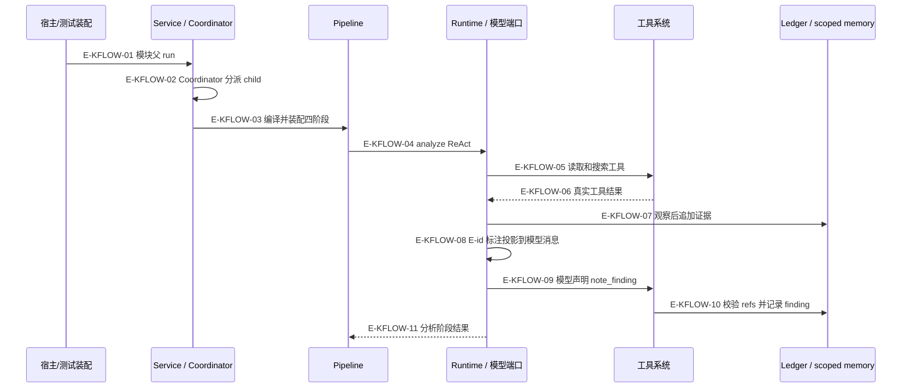
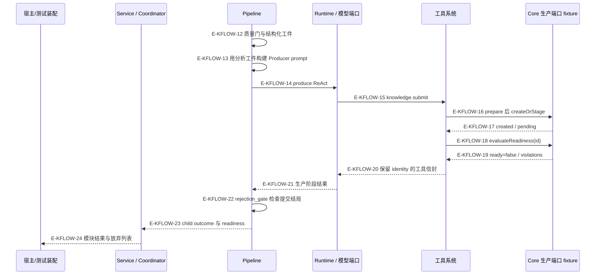

# 从分析发现到知识候选回执

在正确注入的普通 module-mining 路径下，Agent 具备真实 analyze→工具读取→证据台账→结构化发现→质量门→producer→knowledge.submit→Core 生产端口→回执投影组合链。本轮实际运行的 mining-e2e 只证明脚本化模型和内存写口条件下的 wiring/接地/状态行为，不证明真实 LLM 发现质量、生产数据库落库、ready 或发布。

本页定位现有mining E2E的六类用例与断言；是否已执行、输入是否仍匹配，见[定向执行记录](../../evidence/scoped-execution.json)与页面证据。旧版本通过不会作为当前输入的通过证明。

[工具回合样板](complete-sequence.md) · [证据与提交专题](../08-evidence-knowledge/overview.md) · [领域结果矩阵](../09-domain-runs/result-matrix.md)

两张图连续描述同一个普通insight路径。第一张结束于analyze回执，第二张从该回执的质量门继续；不是两个独立运行。

## 1. 分析：请求到可引用发现

### 本图术语说明

| 节点／术语 | 本图中的含义 |
| --- | --- |
| 普通路径 | module-mining-session → child module-mining-dimension → generateDimensionPipeline；不是Strict G1/G2。 |
| Runtime / 模型端口 | 真实Runtime调用脚本provider；同一child的阶段loop之间传递scoped资源。 |
| Ledger / scoped memory | Ledger保存受来源规则约束的证据片段；只有满足类别／范围／freshness要求才可回读原文。ActiveContext持有结构化发现，二者不是同一种数据。 |
| 虚线 | 结果回程；内部记录和模型消息投影由表中指定写方/读方完成。 |

| 编号 | 代码依据 | 测试依据 | 关系与可证明范围 |
| --- | --- | --- | --- |
| E-KFLOW-01 | `src/agent/runs/module-mining/ScopedModuleMiningAgentRun.ts#runScopedModuleMining` → `src/agent/service/AgentService.ts#AgentService.run` | 间接覆盖：`test/mining-e2e-pipeline.test.ts#case:%E7%94%9F%E4%BA%A7%E5%85%A5%E5%8F%A3%20runScopedModuleMining%EF%BC%9A%E4%BF%AE%E5%A4%8D%E5%B1%82%E8%AE%A1%E6%95%B0(evidence_sanitized)%E8%B7%A8%E8%B0%83%E7%94%A8%E7%B4%AF%E8%AE%A1%E5%B9%B6%E6%8A%95%E5%BD%B1%E5%88%B0%20child%20_pipelineOutcome.submitRepairs`；断言已定位，实际执行见页面证据；真实 Agent 组合、脚本模型与内存 gateway。不是对每个内部函数的独立 spy 断言。 | 入口归一 modules 并调用注入 service；返回 status 非 success 时抛 runFailure。runModuleMining 是同函数别名。 主入口不自动提供 scoped memory/gateway/provider；本用例不是直接裸装配。 |
| E-KFLOW-02 | `src/agent/service/AgentService.ts#AgentService.run` → `src/agent/coordination/AgentRunCoordinator.ts#AgentRunCoordinator.run` | 间接覆盖：`test/mining-e2e-pipeline.test.ts#case:%E5%81%A5%E5%BA%B7%E6%A8%A1%E5%9D%97%EF%BC%9Aanalyze(%E7%9C%9F%E5%8F%B0%E8%B4%A6)%E2%86%92note_finding(ledger-id)%E2%86%92%E8%B4%A8%E9%87%8F%E9%97%A8%E2%86%92produce%E2%86%92submit%20%E5%85%A8%E9%93%BE%E4%BA%A7%E5%87%BA%201%20%E6%9D%A1%20rule`；断言已定位，实际执行见页面证据；真实 Agent 组合、脚本模型与内存 gateway。不是对每个内部函数的独立 spy 断言。 | 父 profile concurrency 生效；Coordinator 选择 projectContextModules partitioner，runChildren 以递归 service callback 跑 child，最后选择 moduleMiningResults merger。  |
| E-KFLOW-03 | `src/agent/profiles/AgentProfileCompiler.ts#compileStrategy` → `src/agent/profiles/AgentStageFactoryRegistry.ts#AgentStageFactoryRegistry.build` | 间接覆盖：`test/mining-e2e-pipeline.test.ts#case:%E5%81%A5%E5%BA%B7%E6%A8%A1%E5%9D%97%EF%BC%9Aanalyze(%E7%9C%9F%E5%8F%B0%E8%B4%A6)%E2%86%92note_finding(ledger-id)%E2%86%92%E8%B4%A8%E9%87%8F%E9%97%A8%E2%86%92produce%E2%86%92submit%20%E5%85%A8%E9%93%BE%E4%BA%A7%E5%87%BA%201%20%E6%9D%A1%20rule`；断言已定位，实际执行见页面证据；真实 Agent 组合、脚本模型与内存 gateway。不是对每个内部函数的独立 spy 断言。 | module-mining-dimension 的 pipeline factory 为 generateDimensionPipeline；普通分支按名取 INSIGHT_PRESET 的 analyze/quality_gate/produce/rejection_gate，copy 配置并把动态 analyze 预算合并。 用例没有 spy 直接断言 factory 调用次数；这是经 profile 执行路径的传递覆盖。 |
| E-KFLOW-04 | `src/agent/strategies/pipeline/attempt.ts#runStageAttempt` → `src/agent/runtime/AgentRuntime.ts#AgentRuntime.reactLoop` | 间接覆盖：`test/mining-e2e-pipeline.test.ts#case:%E5%81%A5%E5%BA%B7%E6%A8%A1%E5%9D%97%EF%BC%9Aanalyze(%E7%9C%9F%E5%8F%B0%E8%B4%A6)%E2%86%92note_finding(ledger-id)%E2%86%92%E8%B4%A8%E9%87%8F%E9%97%A8%E2%86%92produce%E2%86%92submit%20%E5%85%A8%E9%93%BE%E4%BA%A7%E5%87%BA%201%20%E6%9D%A1%20rule`；断言已定位，实际执行见页面证据；真实 Agent 组合、脚本模型与内存 gateway。不是对每个内部函数的独立 spy 断言。 | PipelineStrategy.#executeStage 在统一 attempt 内准备 prompt，#runPreparedStage 将阶段 capability、budget、source、scope memory/sharedState 投影到 runLoop。analyze 是 code_analysis，produce 是 knowledge_production；两次独立 ReAct loop 共用 child runtime 与 scoped资源。  |
| E-KFLOW-05 | `src/agent/runtime/toolPipeline/runtimeBridge.ts#executeRuntimeToolCall` → `src/tools/runtime/adapter/ToolRouterAdapter.ts#ToolRouterAdapter.execute` | 间接覆盖：`test/mining-e2e-pipeline.test.ts#case:%E5%81%A5%E5%BA%B7%E6%A8%A1%E5%9D%97%EF%BC%9Aanalyze(%E7%9C%9F%E5%8F%B0%E8%B4%A6)%E2%86%92note_finding(ledger-id)%E2%86%92%E8%B4%A8%E9%87%8F%E9%97%A8%E2%86%92produce%E2%86%92submit%20%E5%85%A8%E9%93%BE%E4%BA%A7%E5%87%BA%201%20%E6%9D%A1%20rule`；断言已定位，实际执行见页面证据；真实 Agent 组合、脚本模型与内存 gateway。不是对每个内部函数的独立 spy 断言。 | 模型 functionCalls 经 AgentRuntime.#processToolCalls、默认 ToolExecutionPipeline 前置门后到 runtime bridge。默认 E2E 路由绑定到 ToolRouterAdapter，后者进 ToolRouter.execute，再由 TOOL_REGISTRY action handler 分派 code.read、memory.note_finding、knowledge.submit。 脚本 provider 的轮序是测试输入；不能归纳为真实 LLM 固定轮数或必然调用这些工具。 |
| E-KFLOW-06 | `src/tools/runtime/adapter/ToolRouterAdapter.ts#ToolRouterAdapter.toEnvelope` → `src/agent/runtime/toolPipeline/runtimeBridge.ts#executeRuntimeToolCall` → `src/agent/runtime/toolPipeline/runtimeBridge.ts#recordExecutedEnvelope` | 间接覆盖：`test/mining-e2e-pipeline.test.ts#case:%E5%81%A5%E5%BA%B7%E6%A8%A1%E5%9D%97%EF%BC%9Aanalyze(%E7%9C%9F%E5%8F%B0%E8%B4%A6)%E2%86%92note_finding(ledger-id)%E2%86%92%E8%B4%A8%E9%87%8F%E9%97%A8%E2%86%92produce%E2%86%92submit%20%E5%85%A8%E9%93%BE%E4%BA%A7%E5%87%BA%201%20%E6%9D%A1%20rule`；断言已定位，实际执行见页面证据；真实 Agent 组合、脚本模型与内存 gateway。不是对每个内部函数的独立 spy 断言。 | Adapter把handler结果归一成ToolResultEnvelope；bridge接收并记录同一信封，供后置观察层消费。 |
| E-KFLOW-07 | `src/agent/evidence/EvidenceCapture.ts#captureEvidenceFromEnvelope` → `src/agent/evidence/EvidenceLedgerStore.ts#EvidenceLedgerStore.append` | 间接覆盖：`test/mining-e2e-pipeline.test.ts#case:%E5%81%A5%E5%BA%B7%E6%A8%A1%E5%9D%97%EF%BC%9Aanalyze(%E7%9C%9F%E5%8F%B0%E8%B4%A6)%E2%86%92note_finding(ledger-id)%E2%86%92%E8%B4%A8%E9%87%8F%E9%97%A8%E2%86%92produce%E2%86%92submit%20%E5%85%A8%E9%93%BE%E4%BA%A7%E5%87%BA%201%20%E6%9D%A1%20rule`；断言已定位，实际执行见页面证据；真实 Agent 组合、脚本模型与内存 gateway。不是对每个内部函数的独立 spy 断言。 | 默认 after 链首先 evidenceCapture；成功/可用 partial 的证据工具按实际展示解析范围并入 JSONL，再把 [evidence] E-n=file:range 放到 envelope.text。read 不是直接调用 ledger，而是执行完成后的观察中间件采集。  |
| E-KFLOW-08 | `src/agent/runtime/toolPipeline/observations.ts#evidenceCapture` → `src/agent/runtime/toolReceipt.ts#projectToolReceipt` → `src/agent/runtime/AgentRuntime.ts#AgentRuntime.processToolCalls` | 间接覆盖：`test/mining-e2e-pipeline.test.ts#case:%E5%81%A5%E5%BA%B7%E6%A8%A1%E5%9D%97%EF%BC%9Aanalyze(%E7%9C%9F%E5%8F%B0%E8%B4%A6)%E2%86%92note_finding(ledger-id)%E2%86%92%E8%B4%A8%E9%87%8F%E9%97%A8%E2%86%92produce%E2%86%92submit%20%E5%85%A8%E9%93%BE%E4%BA%A7%E5%87%BA%201%20%E6%9D%A1%20rule`；断言已定位，实际执行见页面证据；真实 Agent 组合、脚本模型与内存 gateway。不是对每个内部函数的独立 spy 断言。 | 数据交接：观察层根据已确认台账条目更新envelope.text；Runtime将它投影成tool消息。Ledger本身不调用模型。 |
| E-KFLOW-09 | `src/agent/runtime/toolPipeline/runtimeBridge.ts#executeRuntimeToolCall` → `src/tools/runtime/adapter/ToolRouterAdapter.ts#ToolRouterAdapter.execute` | 间接覆盖：`test/mining-e2e-pipeline.test.ts#case:%E5%81%A5%E5%BA%B7%E6%A8%A1%E5%9D%97%EF%BC%9Aanalyze(%E7%9C%9F%E5%8F%B0%E8%B4%A6)%E2%86%92note_finding(ledger-id)%E2%86%92%E8%B4%A8%E9%87%8F%E9%97%A8%E2%86%92produce%E2%86%92submit%20%E5%85%A8%E9%93%BE%E4%BA%A7%E5%87%BA%201%20%E6%9D%A1%20rule`；断言已定位，实际执行见页面证据；真实 Agent 组合、脚本模型与内存 gateway。不是对每个内部函数的独立 spy 断言。 | 模型 functionCalls 经 AgentRuntime.#processToolCalls、默认 ToolExecutionPipeline 前置门后到 runtime bridge。默认 E2E 路由绑定到 ToolRouterAdapter，后者进 ToolRouter.execute，再由 TOOL_REGISTRY action handler 分派 code.read、memory.note_finding、knowledge.submit。 脚本 provider 的轮序是测试输入；不能归纳为真实 LLM 固定轮数或必然调用这些工具。 |
| E-KFLOW-10 | `src/tools/runtime/handlers/memory.ts#handleNoteFinding` → `src/agent/memory/MemoryCoordinator.ts#MemoryCoordinator.noteFinding` | 间接覆盖：`test/mining-e2e-pipeline.test.ts#case:%E5%81%A5%E5%BA%B7%E6%A8%A1%E5%9D%97%EF%BC%9Aanalyze(%E7%9C%9F%E5%8F%B0%E8%B4%A6)%E2%86%92note_finding(ledger-id)%E2%86%92%E8%B4%A8%E9%87%8F%E9%97%A8%E2%86%92produce%E2%86%92submit%20%E5%85%A8%E9%93%BE%E4%BA%A7%E5%87%BA%201%20%E6%9D%A1%20rule`；断言已定位，实际执行见页面证据；真实 Agent 组合、脚本模型与内存 gateway。不是对每个内部函数的独立 spy 断言。 | handler 逐 ref ledger.get，任一无效则整条拒绝；至少一个 file 归属条目使 verified=true。机械生成证据标签后交同 scope 的 MemoryCoordinator，再调用 ActiveContext.noteKeyFinding。存储成功要求 recorded=true 且 target=activeContext。 verified 表示引用可解析且有文件归属，不代表命题语义已被独立证明，也不等同 freshness。memoryFindingCount 在 artifact 中是已存 scratchpad 条数。 |
| E-KFLOW-11 | `src/agent/runtime/AgentRuntime.ts#AgentRuntime.finalize` → `src/agent/runtime/AgentRuntime.ts#AgentRuntime.reactLoop` → `src/agent/strategies/PipelineStrategy.ts#PipelineStrategy.runPreparedStage` | 间接覆盖：`test/mining-e2e-pipeline.test.ts#case:%E5%81%A5%E5%BA%B7%E6%A8%A1%E5%9D%97%EF%BC%9Aanalyze(%E7%9C%9F%E5%8F%B0%E8%B4%A6)%E2%86%92note_finding(ledger-id)%E2%86%92%E8%B4%A8%E9%87%8F%E9%97%A8%E2%86%92produce%E2%86%92submit%20%E5%85%A8%E9%93%BE%E4%BA%A7%E5%87%BA%201%20%E6%9D%A1%20rule`；断言已定位，实际执行见页面证据；真实 Agent 组合、脚本模型与内存 gateway。不是对每个内部函数的独立 spy 断言。 | Runtime完成该次loop，回传reply、toolCalls、usage等阶段结果；Pipeline的runPreparedStage经attempt接收，尚未执行下图的质量门。 |

## 2. 生产：分析工件到候选回执

### 本图术语说明

| 节点／术语 | 本图中的含义 |
| --- | --- |
| Pipeline | 接续前图analyze结果：quality_gate → produce → rejection_gate，再聚合child outcome。 |
| Core端口fixture | createOrStage为内存fake；readiness固定ready:false，没有生产DB或publish行为。 |
| 创建 / readiness | 创建确认保留候选身份；readiness是后续单独查询，不与created合为一个状态。 |
| 虚线 | 结果或数据交接，包含跨层结果投影；不是所有回程都对应直接函数调用。 |

| 编号 | 代码依据 | 测试依据 | 关系与可证明范围 |
| --- | --- | --- | --- |
| E-KFLOW-12 | `src/agent/strategies/PipelineStrategy.ts#PipelineStrategy.evaluateGateResult` → `src/agent/evaluation/gateEvaluators.ts#insightGateEvaluator` → `src/agent/evaluation/analysisArtifact.ts#buildAnalysisArtifact` | 间接覆盖：`test/mining-e2e-pipeline.test.ts#case:%E5%81%A5%E5%BA%B7%E6%A8%A1%E5%9D%97%EF%BC%9Aanalyze(%E7%9C%9F%E5%8F%B0%E8%B4%A6)%E2%86%92note_finding(ledger-id)%E2%86%92%E8%B4%A8%E9%87%8F%E9%97%A8%E2%86%92produce%E2%86%92submit%20%E5%85%A8%E9%93%BE%E4%BA%A7%E5%87%BA%201%20%E6%9D%A1%20rule`；断言已定位，实际执行见页面证据；真实 Agent 组合、脚本模型与内存 gateway。不是对每个内部函数的独立 spy 断言。 | Pipeline调用quality_gate evaluator；从真实工具观察和scoped findings构建分析工件并评估。健康用例通过门，弱模块则走修复或放弃分支。 |
| E-KFLOW-13 | `src/agent/profiles/presets/insightPreset.ts#INSIGHT_PRESET` → `src/agent/prompts/insightProducer.ts#buildProducerPromptV2` | 间接覆盖：`test/mining-e2e-pipeline.test.ts#case:%E5%81%A5%E5%BA%B7%E6%A8%A1%E5%9D%97%EF%BC%9Aanalyze(%E7%9C%9F%E5%8F%B0%E8%B4%A6)%E2%86%92note_finding(ledger-id)%E2%86%92%E8%B4%A8%E9%87%8F%E9%97%A8%E2%86%92produce%E2%86%92submit%20%E5%85%A8%E9%93%BE%E4%BA%A7%E5%87%BA%201%20%E6%9D%A1%20rule`；断言已定位，实际执行见页面证据；真实 Agent 组合、脚本模型与内存 gateway。不是对每个内部函数的独立 spy 断言。 | 工厂返回的 produce 复用该 promptBuilder。Pipeline #resolveStageGateArtifact 按 phaseResults.quality_gate.artifact 取分析工件，不读最近任意 gate artifact；prompt 注入 findings 和 evidenceMap 源码片段。Producer 在 knowledge_production 工具面调用 submit。 INSIGHT_PRESET 是包含回调的配置对象，构造常量时不会直接调用 prompt builder。测试没有断言真实模型理解 prompt，脚本 provider 预先编写了候选。 |
| E-KFLOW-14 | `src/agent/strategies/pipeline/attempt.ts#runStageAttempt` → `src/agent/strategies/PipelineStrategy.ts#PipelineStrategy.runPreparedStage` → `src/agent/runtime/AgentRuntime.ts#AgentRuntime.reactLoop` | 间接覆盖：`test/mining-e2e-pipeline.test.ts#case:%E5%81%A5%E5%BA%B7%E6%A8%A1%E5%9D%97%EF%BC%9Aanalyze(%E7%9C%9F%E5%8F%B0%E8%B4%A6)%E2%86%92note_finding(ledger-id)%E2%86%92%E8%B4%A8%E9%87%8F%E9%97%A8%E2%86%92produce%E2%86%92submit%20%E5%85%A8%E9%93%BE%E4%BA%A7%E5%87%BA%201%20%E6%9D%A1%20rule`；断言已定位，实际执行见页面证据；真实 Agent 组合、脚本模型与内存 gateway。不是对每个内部函数的独立 spy 断言。 | executeStage启动attempt，其回调进入runPreparedStage，再通过scope.runLoop调用Runtime新loop，切换到knowledge_production工具面；与analyze共用child runtime及scoped资源，prompt配置本身不直接调用Runtime。 |
| E-KFLOW-15 | `src/agent/runtime/toolPipeline/runtimeBridge.ts#executeRuntimeToolCall` → `src/tools/runtime/adapter/ToolRouterAdapter.ts#ToolRouterAdapter.execute` | 间接覆盖：`test/mining-e2e-pipeline.test.ts#case:%E5%81%A5%E5%BA%B7%E6%A8%A1%E5%9D%97%EF%BC%9Aanalyze(%E7%9C%9F%E5%8F%B0%E8%B4%A6)%E2%86%92note_finding(ledger-id)%E2%86%92%E8%B4%A8%E9%87%8F%E9%97%A8%E2%86%92produce%E2%86%92submit%20%E5%85%A8%E9%93%BE%E4%BA%A7%E5%87%BA%201%20%E6%9D%A1%20rule`；断言已定位，实际执行见页面证据；真实 Agent 组合、脚本模型与内存 gateway。不是对每个内部函数的独立 spy 断言。 | 模型 functionCalls 经 AgentRuntime.#processToolCalls、默认 ToolExecutionPipeline 前置门后到 runtime bridge。默认 E2E 路由绑定到 ToolRouterAdapter，后者进 ToolRouter.execute，再由 TOOL_REGISTRY action handler 分派 code.read、memory.note_finding、knowledge.submit。 脚本 provider 的轮序是测试输入；不能归纳为真实 LLM 固定轮数或必然调用这些工具。 |
| E-KFLOW-16 | `src/tools/runtime/handlers/knowledge/submission.ts#handleSubmit` → `src/tools/runtime/handlers/knowledge/contracts.ts#RecipeGatewayLike` | 间接覆盖：`test/mining-e2e-pipeline.test.ts#case:%E5%81%A5%E5%BA%B7%E6%A8%A1%E5%9D%97%EF%BC%9Aanalyze(%E7%9C%9F%E5%8F%B0%E8%B4%A6)%E2%86%92note_finding(ledger-id)%E2%86%92%E8%B4%A8%E9%87%8F%E9%97%A8%E2%86%92produce%E2%86%92submit%20%E5%85%A8%E9%93%BE%E4%BA%A7%E5%87%BA%201%20%E6%9D%A1%20rule`；断言已定位，实际执行见页面证据；真实 Agent 组合、脚本模型与内存 gateway。不是对每个内部函数的独立 spy 断言。 | 先验证必填字段、prepareSubmission：refs 展开/freshness、来源清理、有界 coreCode、公开 Core authoring 门及有限 repair。准备完成后紧贴写口检查取消；dedup shared Set 只交副本。RecipeGatewayLike 是 Core RecipeProductionPort 的类型别名，不是 Agent 内部持久化实现。 |
| E-KFLOW-17 | `src/tools/runtime/handlers/knowledge/submission.ts#handleSubmit` → `src/tools/runtime/handlers/knowledge/submissionResult.ts#classifyProductionOutcome` → `src/tools/runtime/handlers/knowledge/submissionResult.ts#completeCreatedSubmission` | 间接覆盖：`test/mining-e2e-pipeline.test.ts#case:%E5%81%A5%E5%BA%B7%E6%A8%A1%E5%9D%97%EF%BC%9Aanalyze(%E7%9C%9F%E5%8F%B0%E8%B4%A6)%E2%86%92note_finding(ledger-id)%E2%86%92%E8%B4%A8%E9%87%8F%E9%97%A8%E2%86%92produce%E2%86%92submit%20%E5%85%A8%E9%93%BE%E4%BA%A7%E5%87%BA%201%20%E6%9D%A1%20rule`；断言已定位，实际执行见页面证据；真实 Agent 组合、脚本模型与内存 gateway。不是对每个内部函数的独立 spy 断言。 | 输入数据回程：注入gateway返回created身份与pending生命周期；handleSubmit分类后进入created处理分支。此处没有readiness，也不把该解释函数画成Core内部实现。 |
| E-KFLOW-18 | `src/tools/runtime/handlers/knowledge/submissionResult.ts#completeCreatedSubmission` → `src/tools/runtime/handlers/knowledge/contracts.ts#RecipeGatewayLike` | 间接覆盖：`test/mining-e2e-pipeline.test.ts#case:%E5%81%A5%E5%BA%B7%E6%A8%A1%E5%9D%97%EF%BC%9Aanalyze(%E7%9C%9F%E5%8F%B0%E8%B4%A6)%E2%86%92note_finding(ledger-id)%E2%86%92%E8%B4%A8%E9%87%8F%E9%97%A8%E2%86%92produce%E2%86%92submit%20%E5%85%A8%E9%93%BE%E4%BA%A7%E5%87%BA%201%20%E6%9D%A1%20rule`；断言已定位，实际执行见页面证据；真实 Agent 组合、脚本模型与内存 gateway。不是对每个内部函数的独立 spy 断言。 | 确认created后单独调用evaluateReadiness(created.id)，这个只读查询由runOperation管理期限/取消。 |
| E-KFLOW-19 | `src/tools/runtime/handlers/knowledge/contracts.ts#RecipeGatewayLike` → `src/tools/runtime/handlers/knowledge/submissionResult.ts#completeCreatedSubmission` | 间接覆盖：`test/mining-e2e-pipeline.test.ts#case:%E5%81%A5%E5%BA%B7%E6%A8%A1%E5%9D%97%EF%BC%9Aanalyze(%E7%9C%9F%E5%8F%B0%E8%B4%A6)%E2%86%92note_finding(ledger-id)%E2%86%92%E8%B4%A8%E9%87%8F%E9%97%A8%E2%86%92produce%E2%86%92submit%20%E5%85%A8%E9%93%BE%E4%BA%A7%E5%87%BA%201%20%E6%9D%A1%20rule`；断言已定位，实际执行见页面证据；真实 Agent 组合、脚本模型与内存 gateway。不是对每个内部函数的独立 spy 断言。 | 端口结果回程：本fixture返回ready:false与retrieval.profile.missing；completeCreatedSubmission保留readiness并写入会话计数盒，不把不可用与明确false合并。 |
| E-KFLOW-20 | `src/tools/runtime/adapter/ToolRouterAdapter.ts#ToolRouterAdapter.toEnvelope` → `src/agent/runtime/toolPipeline/runtimeBridge.ts#recordExecutedEnvelope` → `src/agent/runtime/AgentRuntime.ts#AgentRuntime.processToolCalls` → `src/agent/runtime/toolReceipt.ts#projectToolReceipt` | 间接覆盖：`test/mining-e2e-pipeline.test.ts#case:%E5%81%A5%E5%BA%B7%E6%A8%A1%E5%9D%97%EF%BC%9Aanalyze(%E7%9C%9F%E5%8F%B0%E8%B4%A6)%E2%86%92note_finding(ledger-id)%E2%86%92%E8%B4%A8%E9%87%8F%E9%97%A8%E2%86%92produce%E2%86%92submit%20%E5%85%A8%E9%93%BE%E4%BA%A7%E5%87%BA%201%20%E6%9D%A1%20rule`；断言已定位，实际执行见页面证据；真实 Agent 组合、脚本模型与内存 gateway。不是对每个内部函数的独立 spy 断言。 | handler结果经Adapter归一，bridge记录信封，Runtime保存toolCalls并投影到模型历史；创建身份、生命周期与readiness仍是分别解释的业务字段。 |
| E-KFLOW-21 | `src/agent/runtime/AgentRuntime.ts#AgentRuntime.finalize` → `src/agent/runtime/AgentRuntime.ts#AgentRuntime.reactLoop` → `src/agent/strategies/PipelineStrategy.ts#PipelineStrategy.runPreparedStage` | 间接覆盖：`test/mining-e2e-pipeline.test.ts#case:%E5%81%A5%E5%BA%B7%E6%A8%A1%E5%9D%97%EF%BC%9Aanalyze(%E7%9C%9F%E5%8F%B0%E8%B4%A6)%E2%86%92note_finding(ledger-id)%E2%86%92%E8%B4%A8%E9%87%8F%E9%97%A8%E2%86%92produce%E2%86%92submit%20%E5%85%A8%E9%93%BE%E4%BA%A7%E5%87%BA%201%20%E6%9D%A1%20rule`；断言已定位，实际执行见页面证据；真实 Agent 组合、脚本模型与内存 gateway。不是对每个内部函数的独立 spy 断言。 | Runtime结束produce loop并返回阶段结果；rejection_gate属于Pipeline后续步骤，不在Runtime回程内执行。 |
| E-KFLOW-22 | `src/agent/strategies/PipelineStrategy.ts#PipelineStrategy.evaluateGateResult` → `src/agent/evaluation/gateEvaluators.ts#producerRejectionGateEvaluator` | 间接覆盖：`test/mining-e2e-pipeline.test.ts#case:%E5%81%A5%E5%BA%B7%E6%A8%A1%E5%9D%97%EF%BC%9Aanalyze(%E7%9C%9F%E5%8F%B0%E8%B4%A6)%E2%86%92note_finding(ledger-id)%E2%86%92%E8%B4%A8%E9%87%8F%E9%97%A8%E2%86%92produce%E2%86%92submit%20%E5%85%A8%E9%93%BE%E4%BA%A7%E5%87%BA%201%20%E6%9D%A1%20rule`；断言已定位，实际执行见页面证据；真实 Agent 组合、脚本模型与内存 gateway。不是对每个内部函数的独立 spy 断言。 | Pipeline对produce阶段真实回执进行拒绝门检查；图中健康路径通过，拒绝/重试/放弃逻辑另见失败矩阵。 |
| E-KFLOW-23 | `src/agent/strategies/PipelineStrategy.ts#readRecipeReadinessReports` → `src/agent/strategies/PipelineStrategy.ts#PipelineStrategy.execute` → `src/agent/service/AgentService.ts#AgentService.run` | 间接覆盖：`test/mining-e2e-pipeline.test.ts#case:%E5%81%A5%E5%BA%B7%E6%A8%A1%E5%9D%97%EF%BC%9Aanalyze(%E7%9C%9F%E5%8F%B0%E8%B4%A6)%E2%86%92note_finding(ledger-id)%E2%86%92%E8%B4%A8%E9%87%8F%E9%97%A8%E2%86%92produce%E2%86%92submit%20%E5%85%A8%E9%93%BE%E4%BA%A7%E5%87%BA%201%20%E6%9D%A1%20rule`；断言已定位，实际执行见页面证据；真实 Agent 组合、脚本模型与内存 gateway。不是对每个内部函数的独立 spy 断言。 | Pipeline从sharedState读取readiness报告并写入phases._pipelineOutcome；结果经AgentRuntime.execute到child Service，再供父Coordinator读取。这里是跨层结果投影，不表示Pipeline直接调用Service。 |
| E-KFLOW-24 | `src/agent/coordination/AgentRunCoordinator.ts#collectAbandonedUnits` → `src/agent/coordination/AgentRunCoordinator.ts#mergeProjectIndexScopedModuleResults` → `src/agent/runs/module-mining/ScopedModuleMiningAgentRun.ts#runScopedModuleMining` | 间接覆盖：`test/mining-e2e-pipeline.test.ts#case:%E7%94%9F%E4%BA%A7%E5%85%A5%E5%8F%A3%20runScopedModuleMining%EF%BC%9A%E4%BF%AE%E5%A4%8D%E5%B1%82%E8%AE%A1%E6%95%B0(evidence_sanitized)%E8%B7%A8%E8%B0%83%E7%94%A8%E7%B4%AF%E8%AE%A1%E5%B9%B6%E6%8A%95%E5%BD%B1%E5%88%B0%20child%20_pipelineOutcome.submitRepairs`；断言已定位，实际执行见页面证据；真实 Agent 组合、脚本模型与内存 gateway。不是对每个内部函数的独立 spy 断言。；间接覆盖：`test/mining-e2e-pipeline.test.ts#case:%E5%81%A5%E5%BA%B7%E6%A8%A1%E5%9D%97%EF%BC%9Aanalyze(%E7%9C%9F%E5%8F%B0%E8%B4%A6)%E2%86%92note_finding(ledger-id)%E2%86%92%E8%B4%A8%E9%87%8F%E9%97%A8%E2%86%92produce%E2%86%92submit%20%E5%85%A8%E9%93%BE%E4%BA%A7%E5%87%BA%201%20%E6%9D%A1%20rule`；断言已定位，实际执行见页面证据；真实 Agent 组合、脚本模型与内存 gateway。不是对每个内部函数的独立 spy 断言。；间接覆盖：`test/mining-e2e-pipeline.test.ts#case:%E5%BC%B1%E6%A8%A1%E5%9D%97%EF%BC%9A%E9%9B%B6%E5%8F%91%E7%8E%B0%20%E2%86%92%20record_repair%20%E6%95%91%E4%B8%8D%E5%9B%9E%20%E2%86%92%20degraded_no_findings%20%E2%86%92%20%E7%88%B6%E7%BB%93%E6%9E%9C%20abandonedModules%20%E4%B8%80%E7%AD%89%E5%8F%AF%E8%A7%81`；断言已定位，实际执行见页面证据；真实 Agent 组合、脚本模型与内存 gateway。不是对每个内部函数的独立 spy 断言。；入口case覆盖helper调用，健康/弱模块case分别覆盖父聚合的正常/放弃列表。 | 父Coordinator收集child outcome，聚合moduleResults与可选abandonedModules；入口接收父Service结果并按status决定返回或抛错。健康case直接断言parent success且无abandonedModules；弱模块case不直接断言parent success。 |

## 必须成立的装配

| 资源 | 实际作用与边界 | Agent 定位 |
| --- | --- | --- |
| 真实入口与扇出 | 入口校验非空 modules，先 scaleCap，再拆超大模块，附 contextMap 与模块预算。parent profile 的 concurrency 计划进入 AgentRunCoordinator；父消息不调用模型。partitioner 按 params.modules 生成 child、用 moduleId 读取 childContexts，并透传 execution。 必需输入：AgentService、modules/projectFacts；要形成台账/发现闭环，还需 child scoped 运行资源。入口本身不会创建 MemoryCoordinator、Core gateway 或 AI provider。 | `src/agent/runs/module-mining/ScopedModuleMiningAgentRun.ts#runScopedModuleMining`；`src/agent/runs/module-mining/ScopedModuleMiningAgentRun.ts#selectScopedIndexModulesForRun`；`src/agent/coordination/AgentRunCoordinator.ts#partitionProjectIndexScopedModules` |
| child 编译与 runtime | child profile 经 compileStrategy 调 factory.build 取得四阶段；Builder 合并 insight preset，resolveStrategy 为 pipeline 创建 PipelineStrategy，构建 AgentRuntime。不是调用独立 legacy AnalystAgent/ProducerAgent 类。 必需输入：aiProvider、projectRoot、dataRoot、container capabilityCatalog、必需的toolRegistry最小manifest端口、显式toolRouter或容器toolRouter服务。 | `src/agent/profiles/AgentProfileCompiler.ts#compileStrategy`；`src/agent/profiles/AgentStageFactoryRegistry.ts#AgentStageFactoryRegistry.build`；`src/agent/service/AgentRuntimeBuilder.ts#AgentRuntimeBuilder.build`；`src/agent/profiles/presets/index.ts#resolveStrategy` |
| 同 scope 记忆和共享状态 | SystemRunContext 让 trace 与 activeContext 指向同一 scope，sharedState 带 _dimensionMeta/_dimensionScopeId。Pipeline 展平 system context；request.runtime 保留 memoryCoordinator、ledger、sharedState 和 scope 身份。_sessionCounters 在阶段浅拷贝前预建，避免提交统计写入一次性 runtime 投影后丢失。 必需输入：创建好的 MemoryCoordinator scope 与 SystemRunContext，按 moduleId 注入 childContexts 或等价 runtime context。profile.memory.enabled=false 是未消费描述字段，不会关闭该资源。 | `src/agent/runtime/SystemRunContext.ts#createSystemRunContext`；`src/agent/service/AgentService.ts#buildRuntimeOptions`；`src/agent/strategies/PipelineStrategy.ts#PipelineStrategy.execute`；`src/agent/runtime/toolPipeline/runtimeBridge.ts#buildRuntimeToolCallRequest` |
| ledger 的真实生命周期 | 每次 reactLoop 初始化先 openLoopEvidence，再根据已准备资源查询 schema。jobId 来自 _bootstrapSessionId 或 runtime 固定 fallback；dimension 来自 _dimensionMeta.id 或 scope 前段。analyze/produce在同一child Runtime使用相同坐标与JSONL，并共享Runtime持有的EvidenceSourceDigestTable；每loop新store hydrate旧JSONL，原文摘要表不随store重开丢失。无维度身份返回 null；权威初始化错误抛出，不能静默伪造空台账。 必需输入：稳定 dataRoot、scope/dimension 身份；普通 profile 使用 redacted-evidence，不能等同 verbatim-witness。 | `src/agent/runtime/AgentRuntime.ts#AgentRuntime.initLoop`；`src/agent/evidence/loopLedger.ts#openLoopEvidence`；`src/agent/evidence/ProductionEvidenceLedgerAuthority.ts#openProductionEvidenceLedgerAuthority`；`src/agent/evidence/EvidenceLedgerStore.ts#EvidenceLedgerStore.constructor` |
| E2E 的明确装配 | assembleMiningRun 创建真实 MemoryCoordinator/SystemRunContext、RuntimeCapabilityCatalog、AgentService+AgentRuntimeBuilder 和 ToolRouterAdapter。contextFactory 注入 fixture projectRoot、tokenBudget、fake gateway，并从 request.runtime 接收 scope 资源。生产入口用例另以 agentService.run wrapper 把 childContexts 加回入口生成的请求。 必需输入：该装配是测试宿主；未检查任何真实主宿主或 Core 内部实现。 | `test/mining-e2e-pipeline.test.ts#assembleMiningRun`；`test/mining-e2e-pipeline.test.ts#createFakeGateway`；`test/mining-e2e-pipeline.test.ts#ScriptedMiningProvider` |

## 数据怎样跨阶段保留下来

| 交接 | 载体 | 读取与写入依据 |
| --- | --- | --- |
| 原文 → E-id | envelope.text 的 [evidence] E-n=path:range；或 evidence.search 的 items[{id,file}]。脚本 provider 从下一轮 opts.messages 提取真实 E-id；宽工具返回可能被显示配额截断，所以第二轮按文件做窄 evidence.search。此处是消息数据交接，不是 EvidenceCapture 调用 provider。 | `src/agent/runtime/toolPipeline/observations.ts#evidenceCapture`；`test/mining-e2e-pipeline.test.ts#parseEvidenceRefs` |
| E-id → finding → quality artifact | 同 scope ActiveContext scratchpad，经 MemoryCoordinator.noteFinding/ActiveContext.noteKeyFinding 写入，再 distill().keyFindings 读取。finding.evidence 由台账机械标签生成；file-only 条目也可 verified。不是让 gate 重新解析模型自报 file:line 就视为已采证。 | `src/tools/runtime/handlers/memory.ts#handleNoteFinding`；`src/agent/evaluation/analysisArtifact.ts#buildAnalysisArtifact` |
| quality_gate → Producer | phaseResults.quality_gate.artifact → produce promptBuilder 的 gateArtifact。按门名交接；中间门或 rejection_gate 的最新 artifact 不能顶替分析工件。 | `src/agent/strategies/PipelineStrategy.ts#PipelineStrategy.storeGateResult`；`src/agent/strategies/PipelineStrategy.ts#PipelineStrategy.resolveStageGateArtifact` |
| Analyst 读取接地 → submit 限定修复 | sharedState._analystGraphEvidence / _analystGroundedRanges；_sessionCounters持有跨阶段修复/拒绝/readiness统计；同标题尝试只读盒内_submitTitleAttempts，顶层旧字典不读不写。仅投影真实 graph/grounded ranges，不能由这些字段自授予新权限；裸路径可机械改写为已接地范围。 | `src/agent/evaluation/gateEvaluators.ts#insightGateEvaluator`；`src/tools/runtime/handlers/knowledge/authoring.ts#prepareSubmission` |

## 健康 case 的实际断言

- gateway 收到1条候选，reasoning.evidenceRefs至少3项，sources含真实fixture文件。
- coreCode明确为空；未显式提交有界片段时不从首条来源机械回填。retrievalProfile为null。
- child outcome=completed；recipeReadiness同时是pending、ready:false、retrieval.profile.missing。
- 父结果status=success且没有abandonedModules。四个状态维度不能折成一个“成功”。

## 分支选择与未跨过的边界

- strategyContext.strictProduction.enabled===true 时工厂改走 buildStrictProductionPipelineStagesV1；本 E2E 没注入该字段，不能拿普通 insight 流程为 Strict G1/G2 或宿主封印作证。
- params.needsCandidates===false 时工厂只返回 analyze；本纵切目标是需要候选的四阶段分支。
- hasExistingRecipes===true 且 prescreenDone!==true 时在四阶段之前增加 evolve/evolution_gate；本 E2E 没覆盖该条件。
- 模块 _computedBudget 的三个有效数值字段（maxIterations/timeoutMs/maxSessionInputTokens）覆盖 analyze 静态预算；宿主 runScopedModuleMining.budget 仅提示且记录 not-enforced，不是总候选/token 硬限额。

- 脚本provider依据工具面选择固定回复；它的轮次和候选内容不代表真实模型必然行为。
- 根文件和全部Core内部没有被本任务修改；Core仅作为公开校验合同及外部写口，Core的内部持久化/serving能力由其窗口继续。
- 测试文件头部旧说明中的“零工具”“coreCode回填”不作为事实：no-findings仍真实批读和搜索，只是不记录finding。

[失败与回执处理](../08-evidence-knowledge/failure-and-receipts.md)逐项列出断言依据、执行边界与仍未覆盖的分支。

## 场景：创建确认，但尚未可用

created说明gateway返回了候选身份；pending、ready:false与retrieval.profile.missing是独立readiness事实。不能因“不ready”重发createOrStage，先保留id并由拥有方处理后续readiness。

## 证据原文、来源分类与持久化边界

每个reactLoop经openLoopEvidence新建store，Runtime同时传入同一内存原文摘要表，因而produce重新打开相同JSONL后仍可识别被脱敏遮住的原文变化。摘要按台账路径和E-id分区并绑定落盘身份；seed复制已经投影的内容，不继承兄弟Runtime的原文摘要。不同Runtime／进程仍降级为脱敏哈希，不能宣称跨进程强freshness。

`test/evidence-ledger-readback.test.ts#case:%24name%EF%BC%9A%E5%90%8C%E4%B8%80%E5%BC%A0%E8%A1%A8%E7%9A%84%E4%B8%8B%E4%B8%80%E4%B8%AA%20reactLoop%20store%20%E5%88%A4%20stale%EF%BC%8C%E5%B9%B6%E6%8C%89%E5%8E%9F%E6%96%87%E5%9B%9E%E8%AF%BB`；断言已定位，实际执行见页面证据。两个 openLoopEvidence store 使用同一摘要表；未变 fresh并原文读回，脱敏隐藏范围修改 stale并回退存储内容。 边界：测试模拟每loop开store，未直接跑同一 Runtime 两阶段；Runtime字段接线由源码另证。

普通生产profile由authority注入来源感知规则：terminal正文按敏感赋值／认证头处理；secret-bearing文件全部取值遮蔽且循环采集不保留range、不允许原文回读；普通源码维持开发者底线。见证profile走另一路受约束合同，不能用它放松普通台账。以下断言是临时fixture边界：

`test/evidence-ledger-readback.test.ts#case:terminal%20%E6%9D%A1%E7%9B%AE%E7%BB%8F%E5%BE%AA%E7%8E%AF%E9%87%87%E9%9B%86%E6%8C%89%E7%BB%88%E7%AB%AF%E8%A7%84%E5%88%99%E9%81%AE%E4%BD%8F%E6%95%8F%E6%84%9F%E9%94%AE%E4%B8%8E%E8%AE%A4%E8%AF%81%E5%A4%B4%EF%BC%8Cevidence.get%20%E8%BF%94%E5%9B%9E%E5%AD%98%E5%82%A8%E5%86%85%E5%AE%B9%E4%B8%8D%E5%9B%9E%E8%AF%BB`；断言已定位，实际执行见页面证据。真实循环采集 terminal.exec：PORT 保留、敏感 env/header 遮住，JSONL 无 SYNTHETIC，evidence.get 不回读。

`test/evidence-ledger-readback.test.ts#case:.env%20%E7%BB%8F%E5%BE%AA%E7%8E%AF%20code.read%20%E5%85%A5%E8%B4%A6%EF%BC%9A%E4%B8%A2%E5%BC%83%20range%EF%BC%8C%E6%8C%89%20secret-bearing%20%E8%A7%84%E5%88%99%E9%81%AE%E4%BD%8F%E5%85%A8%E9%83%A8%E5%8F%96%E5%80%BC%E3%80%81%E4%BF%9D%E7%95%99%E9%94%AE%E5%90%8D`；断言已定位，实际执行见页面证据。PORT/DB_HOST/API_TOKEN 值均遮住，range undefined；真实临时 .env。
