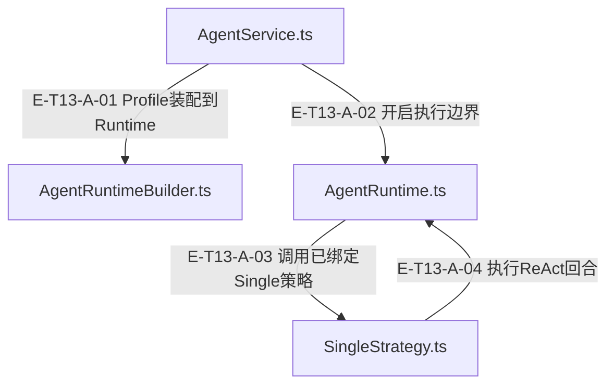

# 13 · 一次请求到工具回执

> 一次请求怎样到工具回执和最终结果；成功、阻断、取消与持久化怎样分别追溯？

这条样板以真实 AgentService、Compiler、Builder、SingleStrategy、Runtime、ToolExecutionPipeline、Adapter、Router 与 code.read 串起一个回合。脚本化模型先请求读文件，再接收真实回执，最后生成回复。宿主上下文和临时文件由 fixture 提供；没有真实网络或知识持久化。

[真实调用](call-flow.md) · [直接依赖](file-dependency.md) · [阅读规范](../00-diagram-standard.md)

## 职责与主要接缝

### 本图术语说明

| 术语／节点 | 含义与范围 |
| --- | --- |
| AgentService.ts | `src/agent/service/AgentService.ts`；本图按实现文件聚合职责；具体装配条件见下表。 |
| AgentRuntimeBuilder.ts | `src/agent/service/AgentRuntimeBuilder.ts`；本图按实现文件聚合职责；具体装配条件见下表。 |
| AgentRuntime.ts | `src/agent/runtime/AgentRuntime.ts`；本图按实现文件聚合职责；具体装配条件见下表。 |
| SingleStrategy.ts | `src/agent/strategies/SingleStrategy.ts`；本图按实现文件聚合职责；具体装配条件见下表。 |

| 编号 | 代码依据 | 测试依据 | 关系与可证明范围 |
| --- | --- | --- | --- |
| E-T13-A-01 | `src/agent/service/AgentService.ts#AgentService.prepareRuntime` → `src/agent/service/AgentRuntimeBuilder.ts#AgentRuntimeBuilder.build` | `test/agent-lifecycle.test.ts#case:service%20compilation%20preserves%20explicit%20preset%20params%20at%20the%20real%20builder%20seam`；传 chat preset params={maxIterations:2,maxTokens:333}，Service使用真实Builder构建，再spy替换runtime.execute；断言真实runtime政策预算保留2/333。只覆盖编译/装配接缝，不覆盖该例中的模型或工具执行。断言已定位，实际执行见页面证据。 | Service传已编译profile，Builder解析preset并new Runtime；Builder内绑定provider、strategyInstance和ToolRouterContract。 |
| E-T13-A-02 | `src/agent/service/AgentService.ts#AgentService.run` → `src/agent/runtime/AgentRuntime.ts#AgentRuntime.execute` | `test/agent-lifecycle.test.ts#case:permits%20the%20first%20model%20call%20when%20the%20iteration%20budget%20is%20one`；harness使用真实Runtime+SingleStrategy，Builder为返回该runtime的替身，provider chat为vi.fn返回done；maxIterations=1，断言Service status=success、reply=done且provider只调用一次。断言已定位，实际执行见页面证据。 | Service已做preflight并扣除耗时，然后runtime.execute(message, buildRuntimeOptions(...))；execute创建resource run并委托策略。 |
| E-T13-A-03 | `src/agent/runtime/AgentRuntime.ts#AgentRuntime.executeRun` → `src/agent/strategies/SingleStrategy.ts#SingleStrategy.execute` | `test/agent-lifecycle.test.ts#case:permits%20the%20first%20model%20call%20when%20the%20iteration%20budget%20is%20one`；harness使用真实Runtime+SingleStrategy，Builder为返回该runtime的替身，provider chat为vi.fn返回done；maxIterations=1，断言Service status=success、reply=done且provider只调用一次。断言已定位，实际执行见页面证据。 | runOperation中调用this.strategy.execute。此边只适用于preset解析为Single或显式注入Single；Pipeline走PipelineStrategy；跨模块／维度协调由Service进入Coordinator并创建独立child Runtime，当前没有FanOutStrategy。 装配：AgentRuntimeBuilder.build绑定strategy=preset.strategyInstance；resolveStrategy的single分支创建SingleStrategy。 |
| E-T13-A-04 | `src/agent/strategies/SingleStrategy.ts#SingleStrategy.execute` → `src/agent/runtime/AgentRuntime.ts#AgentRuntime.reactLoop` | `test/agent-lifecycle.test.ts#case:keeps%20confirmed%20tool%20receipts%20when%20cancellation%20interrupts%20a%20later%20model%20request`；第一次模型返回meta.tools调用，router spy返回observed:true成功信封；第二次模型挂起后runtime.abort，断言Service status=aborted仍保留meta回执/envelope.ok=true，router仅调用一次。真实Runtime/Single/Pipeline，Builder与Router为替身；不证明外部写入已回滚。断言已定位，实际执行见页面证据。 | Single把prompt/history/context/options交给reactLoop；provider有tool calls进入#processToolCalls，纯文本进入#processTextResponse。 |

## 输入、输出与副作用

| 维度 | 当前实现 |
| --- | --- |
| 输入 | 普通请求: AgentRunInput profile/message/context/execution；provider产出的functionCalls须经当前工具schema/白名单/phase/safety约束；允许不是必执行；模型、宿主与Core端口都有替身/真实边界，阅读时先识别装配 |
| 输出 | Service status/reply/usage/toolCalls/phases/diagnostics；模型下一轮看到的是受额度与隐私投影后的tool文本；宿主工具Envelope的规范事实另保留；持久化侧只承认created/id/lifecycle/readiness回执和独立readback |
| 副作用 | Router handler可能执行文件/终端/Core动作；Gate拒绝和preflight取消应证明零执行；确认证据进入ledger，submit去重只有确认创建后登记；scope清理不是数据库撤销 |

## 从这些文件开始

| 文件 | 阅读目的 |
| --- | --- |
| `src/agent/service/AgentService.ts` | 校验与编译入口，选择协调或单 Runtime；有界取消预检、剩余期限、消息投影、结果状态归类及恢复超时诊断投影。 |
| `src/agent/service/AgentRuntimeBuilder.ts` | 把编译产物展开为 preset、每次新建 capabilities、实例化 policy 工厂、注入宿主 provider/router/container 后构造 Runtime。 |
| `src/agent/runtime/AgentRuntime.ts` | 唯一 ReAct 执行内核 |
| `src/agent/strategies/SingleStrategy.ts` | 把消息、history、metadata context 与显式 options 委托 reactLoop。 |
| `src/agent/runtime/ToolExecutionPipeline.ts` | 公开兼容入口与默认中间件装配 |
| `src/agent/runtime/toolPipeline/engine.ts` | 正序before/executor/after驱动 |
| `src/agent/runtime/toolPipeline/runtimeBridge.ts` | 唯一宿主router调用桥 |
| `src/tools/runtime/adapter/ToolRouterAdapter.ts` | ToolRouterContract 实现、context factory、稳定信封与 trust 派生 |
| `src/tools/runtime/router.ts` | 解析、准入、排队重检、互斥调度、handler 分发与字符串截断 |
| `src/agent/runtime/toolReceipt.ts` | 回执身份保存与模型显示配额 |

## 失败、取消与恢复

- 正常工具回合：Router回执经model-safe envelope返回；Runtime createToolReceipt保存原args/result/envelope身份、projectToolReceipt按quota生成模型文本并appendToolResult，下一模型轮生成reply后Service投影。 依据 `test/mining-e2e-pipeline.test.ts#case:%E5%81%A5%E5%BA%B7%E6%A8%A1%E5%9D%97%EF%BC%9Aanalyze(%E7%9C%9F%E5%8F%B0%E8%B4%A6)%E2%86%92note_finding(ledger-id)%E2%86%92%E8%B4%A8%E9%87%8F%E9%97%A8%E2%86%92produce%E2%86%92submit%20%E5%85%A8%E9%93%BE%E4%BA%A7%E5%87%BA%201%20%E6%9D%A1%20rule`（仅定位与阅读）。
- F0请求未开工：Service pre-cancel/shouldAbort或Runtime policy前置拒绝，provider/router不开始。 依据 `test/agent-lifecycle.test.ts#case:reports%20policy%20rejection%20as%20blocked%20without%20calling%20the%20provider`（仅定位与阅读）。
- F1工具被拦：before hook或管道gate可生成阻断回执，router零调用；blockedTools证明被拦工具，不自动等于整次Service status=blocked（模型仍可文本结束）。 依据 `test/agent-lifecycle.test.ts#case:honors%20an%20asynchronous%20tool%20blocking%20hook%20before%20the%20router`（仅定位与阅读）。
- 取消/超时后回读：已确认回执与usage保留，未知在途写入需宿主readback；不合作任务迟到结果被忽略。已有取消与硬超时两套独立断言。 依据 `test/agent-lifecycle.test.ts#case:keeps%20confirmed%20tool%20receipts%20when%20cancellation%20interrupts%20a%20later%20model%20request`（仅定位与阅读）。
- 持久化不是发布：Scan Core集成测试可读回pending且未publish；mining E2E的created是fake gateway，readiness=false与completed可并存。Strict G2存在五个it.fails输入组合，不能画成已闭合生产链。 依据 `test/scan-run-production-integration.test.ts#case:projects%20the%20persisted%20pending%20Recipe%20through%20the%20real%20handler%20and%20Core%20gateway%20seam`（仅定位与阅读）。

## 已知边界与未验证范围

- 组合样板的6类场景与精确断言已定位；当前执行及输入指纹见页面证据，不据历史回执声称当前或全仓通过。
- mining E2E的provider与gateway分别是脚本与内存fake；scan Core集成测试的Runtime为替身。两者互补，但不能合成一次真实provider+durable全链运行事实。
- Strict G2目标契约五个it.fails仍在test/independent-value-reviewer-core-g2-contract.test.ts，两种identity坐标不具可比性；只读本仓记录，不推断相邻宿主已修复。

## 已执行的组合样板

[执行回执](../../evidence/pilot.json)记录成功、白名单拒绝、开工前取消、回执后取消、模型挂起超时、批量读取部分失败。`alembic-agent-architecture-atlas/test/pilot.test.ts`保留真实装配，spy 只观察而不替换实现。Service success 与工具 partial／拒绝可以并存。

[回执回程与停止边界](receipt-and-recovery.md)接着解释回程。

## 完整路线

[一次请求到回执的连续时序](complete-sequence.md)包含模型建议调用、每个管线接缝、code.read、信封回程和第二轮模型输入。

## 下一条完整纵切

[分析发现到知识候选回执](knowledge-production.md)扩展到普通insight四阶段，并把created、readiness、pipeline outcome和Service status分开解释。
