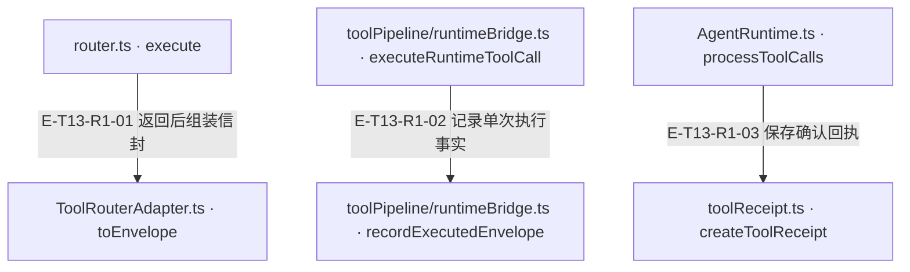
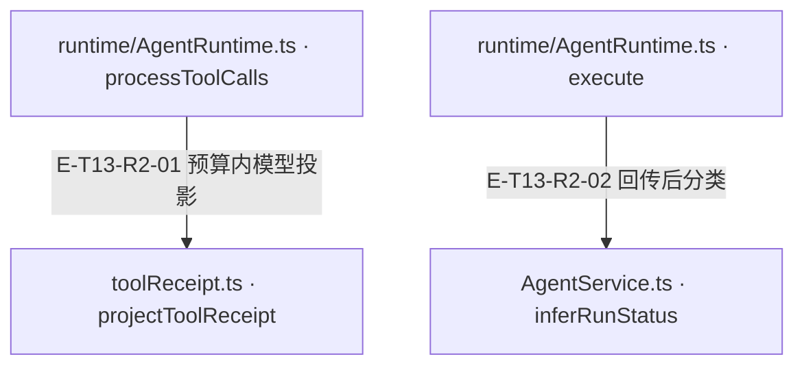

# 回执回程与停止边界

[样板起点](overview.md) · [发起工具调用](call-flow.md)

工具执行完毕只走完了请求的一半。回程保留真实状态与身份，再投影给模型，并写入 Service 的结果。管线提前拒绝时没有 Router 信封，但仍有工具调用记录和 blockedTools 诊断。

## 回程 1

### 本图术语说明

| 术语／节点 | 含义与范围 |
| --- | --- |
| router.ts · execute | `src/tools/runtime/router.ts#ToolRouter.execute`；声明或调用端口；动态实现的绑定条件见下表。 |
| ToolRouterAdapter.ts · toEnvelope | `src/tools/runtime/adapter/ToolRouterAdapter.ts#ToolRouterAdapter.toEnvelope`；声明或调用端口；动态实现的绑定条件见下表。 |
| toolPipeline/runtimeBridge.ts · executeRuntimeToolCall | `src/agent/runtime/toolPipeline/runtimeBridge.ts#executeRuntimeToolCall`；声明或调用端口；动态实现的绑定条件见下表。 |
| toolPipeline/runtimeBridge.ts · recordExecutedEnvelope | `src/agent/runtime/toolPipeline/runtimeBridge.ts#recordExecutedEnvelope`；声明或调用端口；动态实现的绑定条件见下表。 |
| AgentRuntime.ts · processToolCalls | `src/agent/runtime/AgentRuntime.ts#AgentRuntime.processToolCalls`；声明或调用端口；动态实现的绑定条件见下表。 |
| toolReceipt.ts · createToolReceipt | `src/agent/runtime/toolReceipt.ts#createToolReceipt`；声明或调用端口；动态实现的绑定条件见下表。 |

| 编号 | 代码依据 | 测试依据 | 关系与可证明范围 |
| --- | --- | --- | --- |
| E-T13-R1-01 | `src/tools/runtime/router.ts#ToolRouter.execute` → `src/tools/runtime/adapter/ToolRouterAdapter.ts#ToolRouterAdapter.toEnvelope` | 未覆盖：对应样板在本页执行证据表单列；产品内部接缝还需源码语义审阅。 | handler ToolResult在Adapter转换为规范Envelope；status保留handler事实，JSON安全投影不伪造失败。 |
| E-T13-R1-02 | `src/agent/runtime/toolPipeline/runtimeBridge.ts#executeRuntimeToolCall` → `src/agent/runtime/toolPipeline/runtimeBridge.ts#recordExecutedEnvelope` | 未覆盖：对应样板在本页执行证据表单列；产品内部接缝还需源码语义审阅。 | 执行信封进入metadata，记录每调用诊断；structuredContent与text先做模型边界私有字段处理。 |
| E-T13-R1-03 | `src/agent/runtime/AgentRuntime.ts#AgentRuntime.processToolCalls` → `src/agent/runtime/toolReceipt.ts#createToolReceipt` | 未覆盖：对应样板在本页执行证据表单列；产品内部接缝还需源码语义审阅。 | 成功回程和after失败回程都可保留已确认回执；普通回程同时push ctx.toolCalls及this.toolCallHistory。 |

## 回程 2

### 本图术语说明

| 术语／节点 | 含义与范围 |
| --- | --- |
| runtime/AgentRuntime.ts · processToolCalls | `src/agent/runtime/AgentRuntime.ts#AgentRuntime.processToolCalls`；声明或调用端口；动态实现的绑定条件见下表。 |
| toolReceipt.ts · projectToolReceipt | `src/agent/runtime/toolReceipt.ts#projectToolReceipt`；声明或调用端口；动态实现的绑定条件见下表。 |
| runtime/AgentRuntime.ts · execute | `src/agent/runtime/AgentRuntime.ts#AgentRuntime.execute`；声明或调用端口；动态实现的绑定条件见下表。 |
| AgentService.ts · inferRunStatus | `src/agent/service/AgentService.ts#inferRunStatus`；声明或调用端口；动态实现的绑定条件见下表。 |

| 编号 | 代码依据 | 测试依据 | 关系与可证明范围 |
| --- | --- | --- | --- |
| E-T13-R2-01 | `src/agent/runtime/AgentRuntime.ts#AgentRuntime.processToolCalls` → `src/agent/runtime/toolReceipt.ts#projectToolReceipt` | 未覆盖：对应样板在本页执行证据表单列；产品内部接缝还需源码语义审阅。 | quota限制模型文本，code.read被裁剪则失效读取view；之后messages.appendToolResult并带persistedSubmission。 |
| E-T13-R2-02 | `src/agent/runtime/AgentRuntime.ts#AgentRuntime.execute` → `src/agent/service/AgentService.ts#inferRunStatus` | 未覆盖：对应样板在本页执行证据表单列；产品内部接缝还需源码语义审阅。 | execute结果回Service后按明确取消/超时/拒绝/失败诊断及非空reply分类；不把knowledge lifecycle或readiness压成此status。 |

## 两层状态并列读取

| 场景 | Service | 工具记录／信封 | 定位的断言 |
| --- | --- | --- | --- |
| 成功 | success | success 信封 | `alembic-agent-architecture-atlas/test/pilot.test.ts#case:success%3A%20receipt%20is%20returned%20to%20the%20second%20model%20turn%20and%20projected%20by%20Service` |
| 白名单拒绝后文本结束 | success | error payload，无 Router 信封 | `alembic-agent-architecture-atlas/test/pilot.test.ts#case:denied%3A%20an%20unadvertised%20tool%20never%20reaches%20the%20host%20router` |
| 开工前取消 | aborted | 零工具记录 | `alembic-agent-architecture-atlas/test/pilot.test.ts#case:cancel-before%3A%20preflight%20cancellation%20skips%20builder%2C%20model%20and%20router` |
| 回执后取消 | aborted | success 信封保留 | `alembic-agent-architecture-atlas/test/pilot.test.ts#case:cancel-after%3A%20confirmed%20receipt%20survives%20interruption%20before%20the%20next%20turn` |
| 模型端口挂起 | timeout | 零工具记录 | `alembic-agent-architecture-atlas/test/pilot.test.ts#case:timeout%3A%20owned%20deadline%20returns%20a%20timeout%20without%20fabricating%20a%20receipt` |
| 读文件部分失败 | success | partial 信封，成功内容保留 | `alembic-agent-architecture-atlas/test/pilot.test.ts#case:partial%3A%20one%20missing%20file%20preserves%20the%20successful%20read%20in%20a%20partial%20envelope` |

执行状态以[样板回执](../../evidence/pilot.json)的源码和测试摘要为准。该测试使用脚本化 provider；没有验证真实服务商、外部宿主入口、终端沙箱或 Core 持久化。

## 恢复时先确定已有事实

1. Service 预检未开工：没有 Runtime 和工具副作用，重新发起前由上层重新确认输入与期限。
2. 已有确认回执：保留 toolCalls、usage 与原状态；取消并不撤销已经发生的操作。
3. 工具写入已开始而宿主未给确认：需要宿主／Core 的读回能力；本样板只读临时文件，未证明该写入恢复链。
4. scope release 清理缓存／读视图，不是事务回滚。下一次运行必须获得新的执行身份。

宿主 `releaseScope` 是可选端口；本 pilot 没有注入它，未验证真实宿主资源清理。

以上为当前用例定位；执行状态、源码输入指纹与失败观察分别见页面证据。Runtime已不回写渠道，宿主接收result.reply后负责投递；工具确认回执不随通知失败自动重跑。
